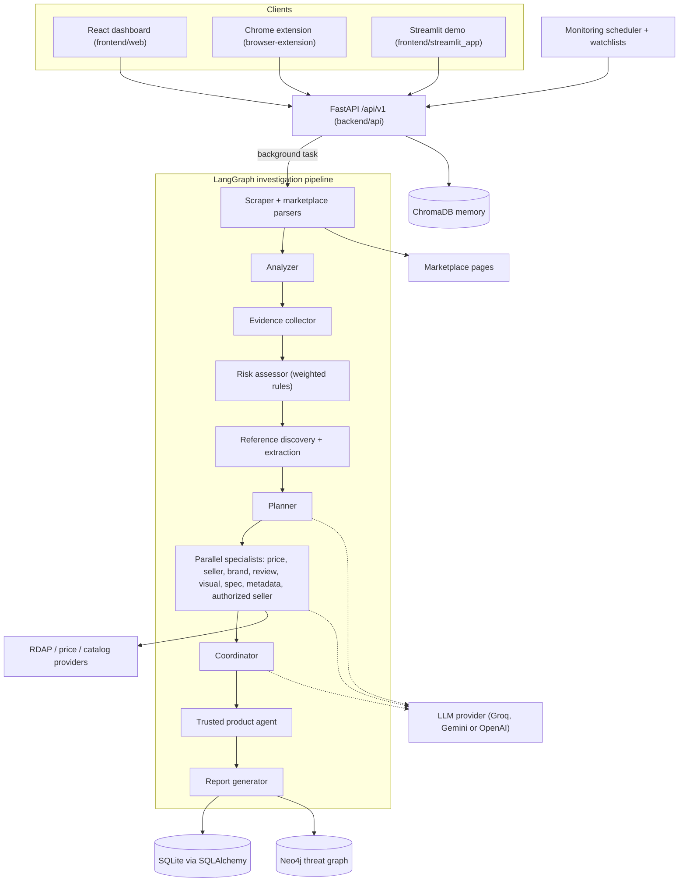

# CounterGuard

A multi-agent system that investigates e-commerce listings for signs of counterfeit or grey-market goods and produces an explainable risk report.


## Overview

Counterfeit and grey-market products are sold openly on marketplaces such as Amazon, Flipkart, Myntra, Ajio, Meesho and TradeIndia. Brand-protection teams usually check them by hand: open the listing, compare the price with the official one, look up the seller, check the specs and photos, then write it up. CounterGuard automates that investigation.

Give it a product listing URL, or a brand and product name to search for. A pipeline of specialised agents then scrapes the listing, scores it on price, specification, brand, seller, review and image signals, cross-checks the findings, and returns a **0 to 100 risk score with the evidence behind it**. Investigations are stored and fed into a seller and brand threat graph. The results can be viewed in a React investigator dashboard, a Chrome extension that inspects the marketplace page you are on, or a Streamlit demo UI.

The project was designed as a short hackathon build ([`ARCHITECTURE.md`](ARCHITECTURE.md) describes the original one-week plan and demo script) and was extended in later sprints. One design rule from the start: **the system drafts escalations but never auto-files takedowns.** A human always approves enforcement.

## Key features

- **Listing scraping.** Each marketplace has its own HTML parser ([`backend/scrapers/`](backend/scrapers/)), chosen by a parser factory. There is a generic fallback and a `cloudscraper` retry when a site returns an anti-bot challenge.
- **LangGraph investigation pipeline** ([`backend/orchestrator/builder.py`](backend/orchestrator/builder.py)): scraper, analyzer, evidence collector, risk assessor, reference discovery and extraction, planner, then up to nine parallel specialist agents, a coordinator, a trusted-product recommender and a report generator.
- **Specialist agents.** Price, Seller, Brand, Review, Visual Forensics, Brand Intelligence, Specification Validation, Authorized Seller and Metadata Intelligence. Each one contributes findings to a shared investigation state.
- **Weighted risk engine.** [`assessor.py`](backend/agents/assessor.py) and [`constants.py`](backend/constants.py) turn the structured evidence into a normalized score and risk level, so the core score does not depend on an LLM.
- **Optional LLM reasoning.** The planner, specialists and coordinator use an OpenAI-compatible client ([`llm_service.py`](backend/services/llm_service.py)) that tries Groq (Llama 3.3 70B), then Gemini, then OpenAI. With no key set, it falls back to structured default output.
- **External lookups.** RDAP/WHOIS for seller domains, a live price adapter, brand-catalog and review-analysis adapters ([`backend/providers/`](backend/providers/)).
- **Visual forensics.** Perceptual image similarity between the listing image and a "golden reference" image, using PIL and NumPy.
- **Threat knowledge graph.** Sellers, brands, listings and their links are stored in Neo4j. Fraud-ring detection, a graph explorer and graph-based retrieval live in [`backend/graph/`](backend/graph/) and [`backend/graphrag/`](backend/graphrag/).
- **Organizational memory.** Past investigations are embedded into ChromaDB. A historical-memory agent finds similar earlier cases.
- **Continuous monitoring.** Watchlists, an APScheduler-based monitoring scheduler, change detection, alerts and an investigation queue ([`backend/automation/`](backend/automation/)).
- **Case management and reporting.** Investigation history with filtering and export, evidence timelines, reasoning traces, consensus views, executive threat reports and gzipped evidence archives.
- **Three clients.** A React dashboard ([`frontend/web/`](frontend/web/)), a Manifest V3 Chrome extension ([`browser-extension/`](browser-extension/)) and a Streamlit demo ([`frontend/streamlit_app/`](frontend/streamlit_app/)). There is also a marketing landing page ([`frontend/landing/`](frontend/landing/)).

## Architecture



| Component | Responsibility |
|---|---|
| **API layer** ([`backend/api/`](backend/api/)) | FastAPI app with about 125 routes under `/api/v1`: investigations, discovery, dashboard, alerts, analytics, graph, fraud rings, memory, scoring, reports, monitoring, watchlists, recommendations, cases, settings, providers, browser extension and health. |
| **Scrapers** ([`backend/scrapers/`](backend/scrapers/)) | `PageFetcher` (requests with a cloudscraper fallback), `MarketplaceDetector` and `ParserFactory`, with parsers for Amazon, Flipkart, Myntra, Ajio, Meesho, TradeIndia and a generic page. |
| **Orchestrator** ([`backend/orchestrator/`](backend/orchestrator/)) | Builds and compiles the LangGraph `StateGraph`. The planner's output decides which specialists run in parallel. Visual forensics always runs. |
| **Agents** ([`backend/agents/`](backend/agents/)) | Analysis, evidence, risk, planning, specialist, coordinator, reporting, historical-memory and fraud-ring agents. |
| **Services** ([`backend/services/`](backend/services/)) | Investigation runner, history, scoring, threat graph, reports, monitoring, LLM client, extraction and validation engines. |
| **Discovery** ([`backend/discovery/`](backend/discovery/)) | Fans out a product search across marketplace adapters in parallel, then deduplicates and ranks the candidates. |
| **Persistence** | SQLite through SQLAlchemy ([`backend/database/`](backend/database/)), Neo4j ([`backend/infrastructure/graph/`](backend/infrastructure/graph/)) and ChromaDB ([`backend/memory/`](backend/memory/)). |
| **Collaboration** ([`backend/collaboration/`](backend/collaboration/)) | Delegation, consensus, validation, explainability and timeline services for agent cooperation. |

The original agent-to-agent design, with bounded cross-queries and a shared evidence timeline, is shown in [`agent_flow.mermaid`](agent_flow.mermaid). Its runnable skeleton with mocked model calls is [`orchestrator.py`](orchestrator.py).

## How it works

1. **Start an investigation.** A client calls `POST /api/v1/investigations` with a listing URL, or with a brand and product (stored as a `search://brand/product` target). The record is saved as `pending` and `InvestigationRunner` runs as a FastAPI background task. `POST /api/v1/investigate` runs the same pipeline synchronously and returns the report directly.
2. **Recall memory.** The historical-memory agent looks for similar past investigations in ChromaDB.
3. **Scrape.** The scraper detects the marketplace, fetches the page and parses title, price, seller, rating, images and specifications into a structured result.
4. **Analyze, collect and score.** The analyzer extracts heuristics such as price deviation, keyword stuffing and seller rating. The collector turns them into structured evidence. The risk assessor applies weighted rules (price/MSRP deviation, specification mismatch, brand authenticity and others) to produce a 0 to 100 score.
5. **Reference lookup.** Reference agents find and extract the official product listing to compare against.
6. **Plan and fan out.** The planner chooses which specialists to run. They execute in parallel, call their tools (WHOIS/RDAP, price, catalog, reverse image) and, when a key is configured, an LLM.
7. **Coordinate and report.** The coordinator merges the specialist findings. The trusted-product agent suggests legitimate alternatives. The reporter builds an `InvestigationReport` with summary, risk score and level, findings, recommendation, confidence and an optional data-confidence warning.
8. **Persist and enrich.** The report and evidence go to SQLite, entities go into the Neo4j threat graph, and timelines, reasoning and evidence can then be read through `/investigations/{id}/...` endpoints or streamed through `/investigations/{id}/stream`.

## Tech stack

| Layer | Technologies |
|---|---|
| Backend | Python 3.11, FastAPI, Uvicorn, Pydantic v2, pydantic-settings |
| Agents | LangGraph, OpenAI Python SDK (used for Groq, Gemini and OpenAI endpoints) |
| Scraping | requests, BeautifulSoup4, lxml, cloudscraper, httpx |
| Data | SQLAlchemy + SQLite, Neo4j 5, ChromaDB, APScheduler |
| Image analysis | Pillow, NumPy |
| Web dashboard | React, TypeScript, Vite, Tailwind CSS, TanStack Query, React Router, React Hook Form + Zod, Recharts, Cytoscape.js, MSW (mock mode) |
| Browser extension | Chrome Manifest V3, React, TypeScript, Vite, Tailwind CSS |
| Demo UI | Streamlit, pandas, Plotly |
| Tooling | pytest, Vitest, Ruff, pre-commit, Docker, GitHub Actions |

## Project structure

```text
counterguard-ai/
├── backend/
│   ├── api/                 # FastAPI app (main.py) and route modules
│   ├── orchestrator/        # LangGraph graph builder and routing
│   ├── agents/              # Analyzer, assessor, planner, specialists, coordinator, reporter, visual, ...
│   ├── scrapers/            # Page fetcher, marketplace detector, per-marketplace parsers
│   ├── discovery/           # Multi-marketplace product search, deduplication, ranking
│   ├── providers/           # RDAP/WHOIS, price, brand catalog, review adapters
│   ├── services/            # Investigation runner, history, scoring, reports, LLM client, ...
│   ├── graph/  graphrag/    # Neo4j threat graph and graph-based retrieval
│   ├── memory/              # ChromaDB-backed investigation memory
│   ├── automation/          # Watchlists, scheduler, change detection, alerts, queue
│   ├── collaboration/       # Delegation, consensus and explainability services
│   ├── database/  models/   # SQLAlchemy engine, repositories and models
│   ├── schemas/             # Pydantic request/response models
│   ├── constants.py         # Risk weights and thresholds
│   ├── tests/               # pytest suite
│   └── requirements.txt
├── frontend/
│   ├── web/                 # React investigator dashboard
│   ├── landing/             # Marketing landing page
│   └── streamlit_app/       # Streamlit demo UI
├── browser-extension/       # Chrome extension (popup, content overlay, DOM adapters)
├── orchestrator.py          # Original runnable skeleton with mocked agents
├── agent_flow.mermaid       # Original agent collaboration sequence
├── ARCHITECTURE.md          # Original multi-agent design spec
├── DEPLOYMENT.md  OPERATIONS_RUNBOOK.md
├── docker-compose.yml       # backend + frontend + Neo4j
└── Makefile                 # build/up/down/test/lint shortcuts
```

## Getting started

### Prerequisites

- Python 3.11
- Node.js 20 and npm
- Optional: Neo4j 5 (for example through `docker compose up neo4j`). Without it, the API logs a warning and graph features are degraded.
- Optional: an API key for Groq, Gemini or OpenAI for LLM reasoning and embeddings

### Environment variables

Create a `.env` at the repository root (template: [`.env.example`](.env.example)).

| Variable | Purpose |
|---|---|
| `GROQ_API_KEY`, `GEMINI_API_KEY`, `OPENAI_API_KEY` | LLM provider (first one set wins). OpenAI is also used for memory embeddings. |
| `DATABASE_URL` | SQLAlchemy URL (default `sqlite:///./counterguard.db`) |
| `NEO4J_URI`, `NEO4J_USERNAME`, `NEO4J_PASSWORD`, `NEO4J_DATABASE` | Neo4j connection |
| `CHROMADB_PATH` | ChromaDB directory setting (declared in `backend/core/config.py` and `docker-compose.yml`) |
| `CORS_ORIGINS` | Comma-separated allowed origins for the API |
| `SCRAPE_TIMEOUT`, `MAX_RETRIES`, `USER_AGENT` | Scraper behavior |
| `SECRET_KEY`, `RATE_LIMIT_PER_MINUTE`, `MAX_CONCURRENT_INVESTIGATIONS` | Platform settings read by [`backend/core/config.py`](backend/core/config.py) |

Frontend ([`frontend/web/.env.example`](frontend/web/.env.example)):

| Variable | Purpose |
|---|---|
| `VITE_API_BASE_URL` | Backend base URL (`http://localhost:8000` in development, `/api` behind Nginx) |
| `VITE_REALTIME_PROVIDER` | Real-time transport: `sse` (default) or `websocket` |
| `VITE_ENABLE_MOCKS` | `true` serves the dashboard from MSW mock handlers without a backend |

### Run the backend

The backend imports use the `backend.` package prefix, so run it from the repository root:

```bash
python -m venv .venv
source .venv/bin/activate              # Windows: .venv\Scripts\activate
pip install -r backend/requirements.txt
# Also imported by the code but not yet listed in requirements.txt:
pip install apscheduler httpx cloudscraper numpy pillow psutil
uvicorn backend.api.main:app --reload --port 8000
```

API docs are at `http://localhost:8000/docs`.

### Run the clients

```bash
# React dashboard (http://localhost:5173)
cd frontend/web && npm ci && npm run dev

# Chrome extension: build, then load browser-extension/dist as an unpacked extension
cd browser-extension && npm ci && npm run build

# Streamlit demo
pip install -r frontend/requirements.txt
streamlit run frontend/streamlit_app/Home.py
```

The dashboard login is a mock: `/api/v1/auth/login` accepts any credentials and returns a demo investigator profile.

### Tests and linting

```bash
make test                            # pytest backend/tests
make lint                            # ruff check .
cd frontend/web && npx vitest run    # dashboard unit tests
cd browser-extension && npm test     # extension unit tests
```

## API usage

Synchronous investigation:

```bash
curl -X POST http://localhost:8000/api/v1/investigate \
  -H "Content-Type: application/json" \
  -d '{"listing_url": "https://www.flipkart.com/...", "marketplace": "Flipkart"}'
```

The response is an `InvestigationReport` ([`backend/schemas/investigation.py`](backend/schemas/investigation.py)):

```json
{
  "summary": "...",
  "product": "...",
  "marketplace": "Flipkart",
  "seller": "...",
  "price": 0.0,
  "risk_score": 0,
  "risk_level": "...",
  "evidence_summary": {},
  "findings": ["..."],
  "recommendation": "...",
  "confidence": 0.0,
  "ai_summary": "",
  "ai_reasoning": "",
  "investigation_timestamp": "...",
  "recommended_products": [],
  "data_confidence_warning": null
}
```

Other useful endpoints (all under `/api/v1`):

| Endpoint | Purpose |
|---|---|
| `POST /investigations` | Queue an asynchronous investigation (returns `202`) |
| `GET /investigations/{id}/timeline`, `/reasoning`, `/evidence`, `/report`, `/graph`, `/consensus` | Inspect a finished investigation |
| `GET /investigations/{id}/stream` | Stream investigation progress |
| `POST /investigations/{id}/ask` | Ask a follow-up question about an investigation |
| `POST /discovery/search`, `POST /discovery/launch` | Search for a product across marketplaces and launch batch investigations |
| `POST /browser/analyze` | Analyze the listing the Chrome extension is viewing |
| `GET /health`, `/health/neo4j`, `/health/chromadb`, `/metrics` | Health and metrics |

## Limitations and roadmap

- **Prototype status.** Many dashboard pages ship with mock repositories (`*.mock.ts`) and can run fully on MSW mocks. Authentication is a stub that returns a fixed demo user and mock tokens.
- **Discovery results are synthetic.** The marketplace discovery adapters in [`backend/discovery/adapters/`](backend/discovery/adapters/) build candidate listings from the query and a marketplace search URL instead of scraping real search results. Investigating a specific listing URL does fetch and parse the real page.
- **Golden reference images are not in the repository.** Visual forensics expects images under `data/golden_reference/`.
- **Risk weights are hand-tuned.** The 70% escalation threshold is a placeholder awaiting labeled data (see [`ARCHITECTURE.md`](ARCHITECTURE.md)).
- **Container setup needs fixing.** [`docker-compose.yml`](docker-compose.yml) points to `frontend/web/Dockerfile`, but the file is `frontend/web/Dockerfile.prod`. The backend Dockerfile copies a root-level `requirements.txt` and starts `api.main:app`, while the code expects `backend.api.main:app`. `requirements.txt` is also missing some imported packages (listed above). Until this is fixed, the local commands above are the reliable way to run the project.
- **Backend CI does not run tests yet.** The pytest step in [`.github/workflows/ci.yml`](.github/workflows/ci.yml) is a placeholder. The frontend job runs lint, type-check, Vitest and build.
- **Takedowns are never automated.** Legal escalation produces drafts for human review only, by design.

## Author

Built by [Suriyaprakash](https://github.com/suriyaprakash-25).
